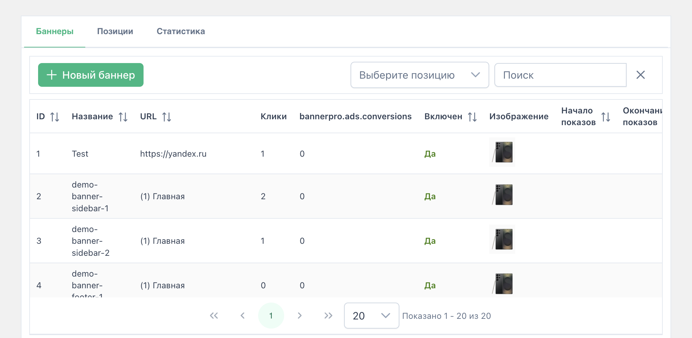
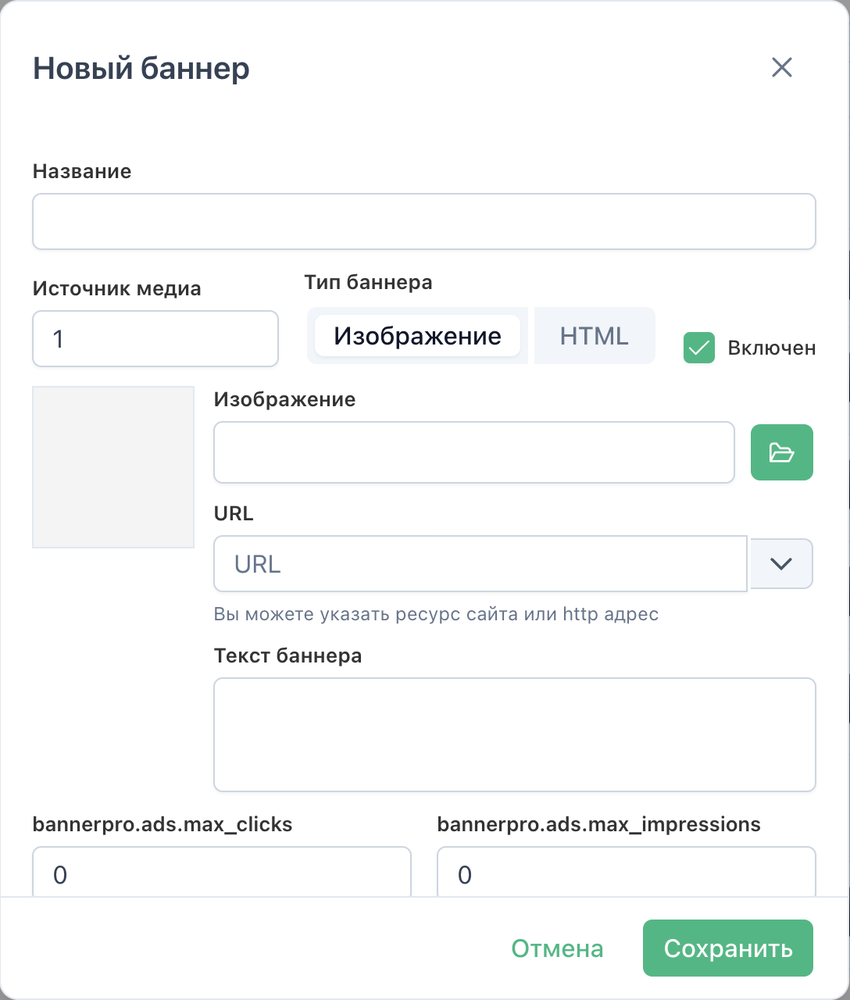
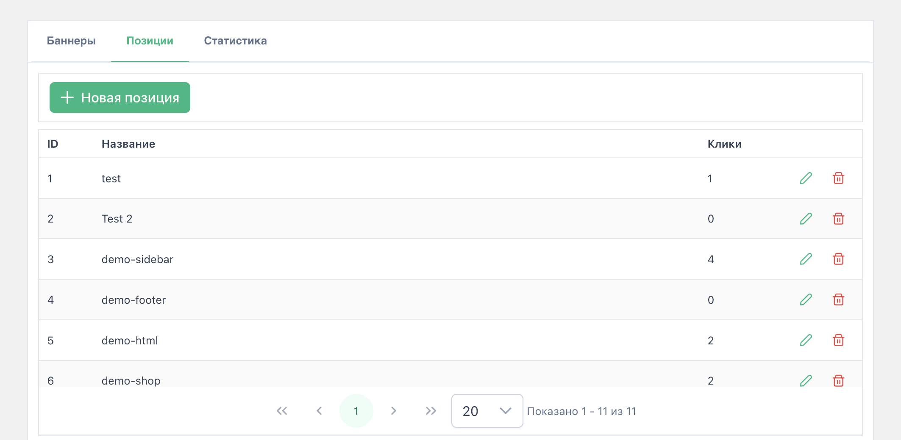
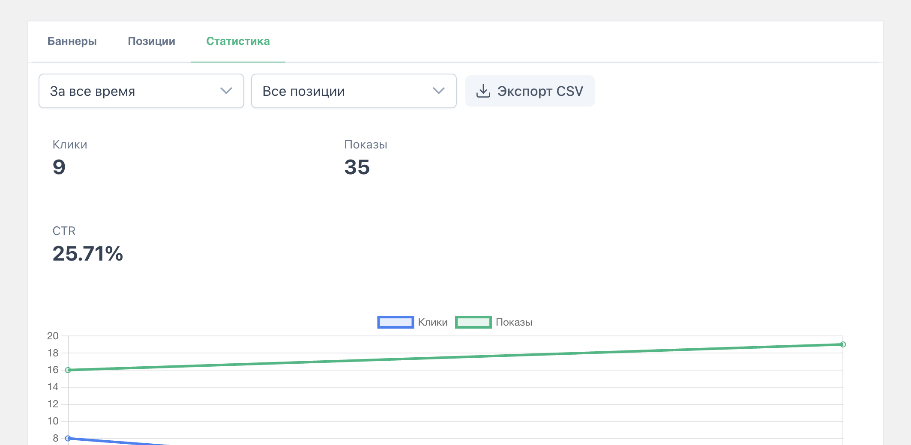
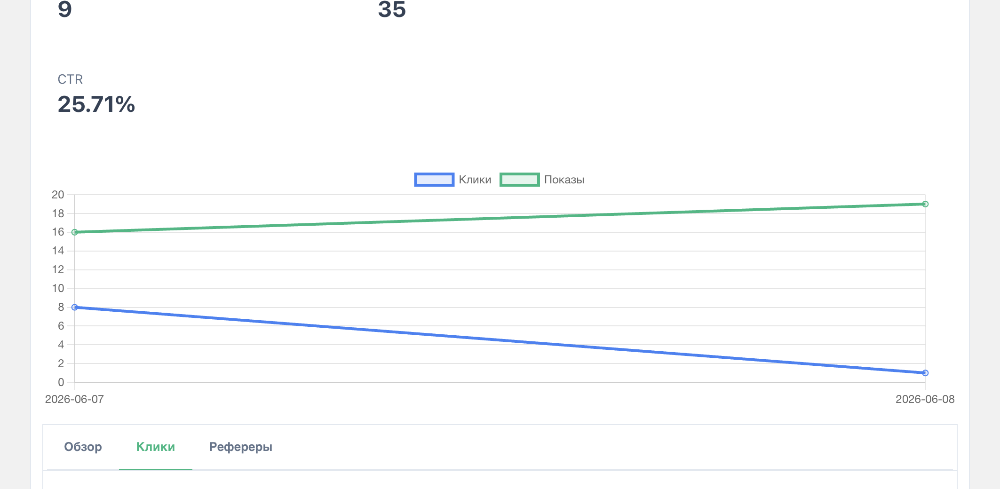
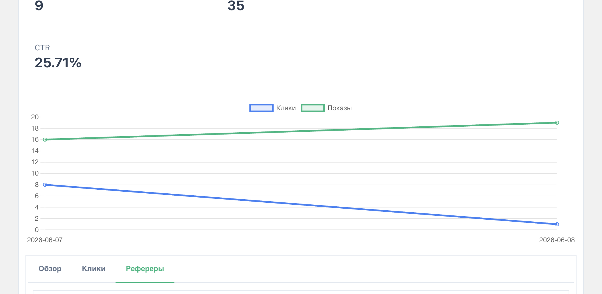

# Руководство по админке

Админка BannerPro: **Компоненты → BannerPro** (`manager/?a=index&namespace=bannerpro`). Реализована на **Vue 3 + PrimeVue** через пакет **VueTools**.

Три вкладки: **Баннеры**, **Позиции**, **Статистика**; с 4.6.0 — также **Журнал** (audit) для пользователей с `bannerpro_save`. Скриншоты с демо-данными — в [images/manager/](images/manager/).



## Требования

- Право **view** (просмотр менеджера)
- **VueTools** — без него страница покажет предупреждение, интерфейс не загрузится

## Права доступа (с 4.1.0)

| Permission | Что разрешает |
|------------|---------------|
| `bannerpro_save` | Создание/редактирование баннеров и позиций, вес, порядок, вкл/выкл |
| `bannerpro_remove` | Удаление баннеров и позиций |
| `bannerpro_stats` | Вкладка «Статистика», экспорт CSV, графики, виджет сводки |

Без `bannerpro_save` интерфейс только для чтения: кнопки создания и редактирования скрыты. Мутации через connector вернут HTTP 403.

### Режим «только статистика» (с 4.6.0)

Если у пользователя есть `bannerpro_stats`, но **нет** `bannerpro_save` и `bannerpro_remove`, открывается **только вкладка «Статистика»** (вкладки «Баннеры» и «Позиции» скрыты). Подходит для аналитиков и заказчиков без права редактирования.

| save | remove | stats | UI |
|------|--------|-------|-----|
| 1 | * | * | Полный доступ (как раньше) |
| 0 | 0 | 1 | Только «Статистика» |

## Сводка «Последние 7 дней» (с 4.6.0)

Над вкладками (при наличии `bannerpro_stats`) — карточки **клики**, **показы**, **CTR** за последние 7 дней. Кнопка **«Подробнее»** переключает на вкладку «Статистика». Данные не требуют перехода в статистику для быстрого обзора.

Назначение прав: [configuration.md](configuration.md#права-доступа-с-410).

## Вкладка «Баннеры»

### Список

- Серверная пагинация (10 / 20 / 50 строк), сортировка по колонкам
- Поиск по названию и описанию
- Фильтры (с 4.6.0): **активен**, **тип** (image/html), **товар** (все / без товара / конкретный), **категория MS3**, **метка**, **позиция**
- Кнопка **«Создать из шаблона»** — preset-баннеры из `bannerpro_ad_templates`
- **Массовые действия** (чекбоксы): включить, выключить, удалить, назначить позиции
- Колонка **URL** — текст `(id) pagetitle` для `[[~id]]`, без HTML-разметки
- Колонки **Клики**, **Заказы** (`conversions` — атрибуция MS3)
- Двойной клик по строке — редактирование
- Колонка действий справа: редактирование, вкл/выкл, удаление

### Создание / редактирование



| Поле | Описание |
|------|----------|
| Название | Внутреннее имя баннера |
| Тип | **Изображение** или **HTML** (AdSense, embed и т.д.) |
| URL | `[[~id]]` ресурса или внешний адрес; поддерживаются плейсхолдеры для клика |
| Источник файлов | Media Source для изображения |
| Активен | Вкл/выкл показ (если не `showInactive` на сайте) |
| Изображение | Выбор через браузер медиа (тип «Изображение») |
| HTML | Код баннера (тип «HTML»); при заданном URL оборачивается в ссылку клика |
| Описание | Текст (alt/title в шаблоне) |
| Начало / Конец | Период показа (пусто = без ограничения) |
| Лимит кликов / показов | `max_clicks`, `max_impressions` (0 = без лимита); при достижении баннер скрывается на сайте, `active` не сбрасывается |
| Позиции | MultiSelect: одна или несколько рекламных позиций |
| Расписание показа (4.6.0) | Дни недели и часы (`show_hours`); пусто = без ограничений по часам в рамках start/end |
| Страница / раздел (4.6.0) | Таргетинг: конкретный ресурс **или** дочерние страницы раздела (не оба сразу) |
| Метки (4.6.0) | Теги для фильтра `&tags=` в сниппете |
| Товар (MiniShop3) | Опционально: привязка к `msProduct`; плейсхолдеры `product_*` на сайте — см. [integrations/minishop3.md](integrations/minishop3.md) |
| Категория (MiniShop3, 4.6.0) | Баннер для товаров в категории; взаимоисключимо с полем «Товар» |

**С 4.4.0 (баннеры):**

- **Дублировать** (иконка копии в строке таблицы) — копия с теми же позициями, порядком (`idx`) и весом; к названию « (копия)».
- **Превью** — миниатюра для «Изображение»; для «HTML» — iframe sandbox.

**С 4.5.0 (позиции):**

- **Дублировать** — копия позиции с теми же баннерами, порядком и весом.
- **Контекст** — поле `context_key`; пусто = все контексты MODX.

### Поле «Товар (MiniShop3)»

- **MultiSelect** (один товар): серверный поиск по названию, как в ms3ProductSets
- При открытии списка и при вводе в фильтр — запрос `resource_getlist` (`class_key` с `msProduct`, до **200** записей за раз)
- При редактировании привязанный товар всегда остаётся в списке, даже если не попал в текущую выборку
- **Подставить URL** — в поле ссылки записывается `[[~{id}]]`
- **Отвязать** — сброс `product_id` (баннер снова глобальный)

В каталогах на десятки тысяч товаров список не грузит весь каталог: только результаты поиска или первые 200 по алфавиту без фильтра.

Интерфейс и сообщения об ошибках локализованы через лексикон (`ru` / `en` / `uk`); язык менеджера — настройка `manager_language`.

### Действия

- Включить / выключить из контекстного меню
- Удалить (с подтверждением)

### Что попадает на сайт

Для каждой пары «баннер + позиция» создаётся запись `byAdPosition` с полем `idx` (порядок). В шаблоне используйте плейсхолдер **`adposition`** — это ID этой связи для ссылки клика.

---

## Вкладка «Позиции»

Позиция — логический слот на сайте (`sidebar`, `header`, `footer` и т.д.).



### Список

- Пагинация (10 / 20 / 50 / 100), двойной клик — редактирование
- Колонки: ID, название, контекст, клики
- Колонка действий **справа** (как на вкладке «Баннеры»): редактирование, дублирование, удаление

| Действие | Описание |
|----------|----------|
| Создать | Имя позиции и опционально контекст |
| Редактировать | Имя, контекст + список баннеров в позиции |
| Дублировать | Копия позиции с теми же баннерами, порядком и весом (с 4.5.0) |
| Удалить | Удаляет позицию (связи с баннерами учитывайте) |

**Контекст** (`context_key`): ключ MODX (`web`, `mgr`, …). Пустое поле — позиция доступна во **всех** контекстах. На сайте сниппет фильтрует позиции автоматически; явный override — `&context=` ([frontend-guide.md](frontend-guide.md)).

### Баннеры в позиции (в диалоге редактирования)

- Добавить баннер из списка (исключая уже привязанные)
- Удалить из позиции
- Изменить порядок (`idx`) **перетаскиванием строк** (drag-and-drop в таблице)
- Задать **вес** (`weight`, мин. 1) для взвешенной ротации на сайте (`sortby=weighted`)

На сайте порядок задаётся параметром сниппета `sortby=idx` и `sortdir=ASC`; ротация по весу — `sortby=weighted`.

### Имя или ID позиции для сниппета

Используйте **`positionName`** (имя из админки, напр. `sidebar`):

```fenom
{'!BannerPro' | snippet : ['positionName' => 'sidebar', 'tpl' => 'byAd']}
```

Альтернатива — числовой **`position`** (ID из БД или списка позиций).

---

## Вкладка «Статистика»



### Фильтры и KPI

- Выпадающий список **периода** (за всё время, сегодня, **последние 7 дней**, **эта/прошлая неделя**, текущий/прошлый месяц, текущий год)
- Фильтр по **позиции** (все или одна)
- Переключатель **«Сравнить с прошлой неделей»** (4.6.0): два ряда на графике и % delta в KPI
- KPI: **клики**, **показы**, **CTR**, **заказы** (атрибуция MS3)
- График по дням (клики и показы)
- Кнопка **Экспорт CSV** (сводка)

Период выбирается только в выпадающем списке; дублирующей подписи рядом с фильтрами нет.

### Вкладки

| Вкладка | Содержимое |
|---------|------------|
| Обзор | Топ баннеров: клики, показы, заказы, CTR; **серверная пагинация** (10 / 20 / 50) |
| Клики | Столбчатый график по баннерам |
| Рефереры | Таблица referrer + клики (с учётом фильтра позиции) |





### Ограничения учёта

**Клики:** один с IP в сутки на пару баннер+позиция; URL `/{bannerpro_click}/{adposition}`.

**Показы:** включаются настройкой `bannerpro_track_impressions`; один показ с IP в сутки; фиксация через `IntersectionObserver` (50% видимости) и pixel `/{bannerpro_impression}/{adposition}`.

### Прокрутка в менеджере MODX

Контент админки прокручивается в `#modx-content` (область MODX между шапкой и подвалом). Внутренние таблицы PrimeVue не создают отдельный вертикальный скролл — длинные списки и вкладка «Статистика» прокручиваются вместе со страницей. Стили: `assets/components/bannerpro/css/mgr/main.css`.

---

## Вкладка «Журнал» (с 4.6.0)

Доступна пользователям с `bannerpro_save`. Таблица audit log: дата, пользователь, действие (create, update, bulk_enable, …), объект (баннер/позиция), ID, краткое описание изменений. Фильтры по типу объекта и действию.

---

## Типичный рабочий процесс

1. **Позиции** → создать `sidebar` (ID = 3)
2. **Баннеры** → создать баннеры, привязать к `sidebar`
3. В шаблоне сайта — вызов сниппета с `position => 3`
4. **Статистика** → проверить клики после публикации

## Связь с фронтендом

Подробные примеры Fenom/MODX: [frontend-guide.md](frontend-guide.md).
