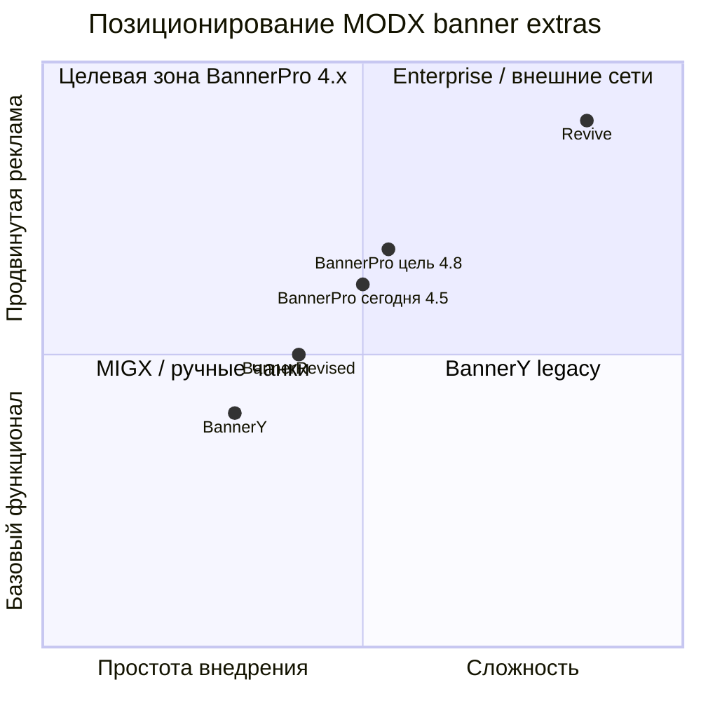

# Роадмап BannerPro

Сравнение с аналогами в экосистеме MODX и план развития пакета.

**Текущая версия:** 4.8.1-pl
**Дата документа:** 2026-06-26

**Легенда статусов:** ✅ сделано · 🔜 запланировано · ⏳ в работе · ❌ не начато · ⚠️ частично / обходной путь

---

## Позиционирование

BannerPro — самостоятельный баннерный extra для MODX 3. Для сайтов, где нужны слоты, ротация, клики и админка без ad-сети (Revive, Google Ad Manager и т.п.).

| Решение | Аудитория | Сильная сторона | Слабая сторона |
|---------|-----------|-----------------|----------------|
| **BannerPro** (4.8) | MODX 3, PHP 8.2+ | Vue 3 + PrimeVue 4, CTR/показы, кэш, MS3, лимиты, REST read, UTM + webhook в mgr, duplicate, context, targeting, bulk, audit, A/B split | REST write, frequency cap, CI/modstore |
| **BannerY** | MODX 2.x, legacy | Зрелая база, modstore | ExtJS, без MODX 3, мало обновлений с ~2019 |
| **BannerRevised** | MODX 2/3 | HTML + Image типы, `tplHtml*` | ExtJS-менеджер, PHP 7.2+, форк без Vue |
| **BannerX** | — | Исторический предок | Снят с поддержки |
| **MIGX / TV / чанки** | Любой MODX | Полная гибкость | Нет кликов, ротации, статистики из коробки |
| **Revive / внешняя сеть** | Медиа, агентства | Кампании, веса, отчёты | Отдельный сервис, сложная интеграция |

---

## Матрица функций (текущее состояние)

| Функция | BannerPro | BannerY | BannerRevised | «Нужно рынку» |
|---------|:--------:|:-------:|:-------------:|:-------------:|
| MODX 3 + PHP 8.2 | ✅ | ❌ | ⚠️ 7.2+ | ✅ |
| Современная админка | ✅ Vue 3 + PrimeVue 4 | ❌ ExtJS | ❌ ExtJS | ✅ |
| Позиции + порядок (`idx`) | ✅ | ✅ | ✅ | ✅ |
| Расписание start/end | ✅ | ✅ | ✅ | ✅ |
| Учёт кликов + рефереры | ✅ | ✅ | ✅ | ✅ |
| pdoTools (`where`, join, tpl*) | ✅ | ✅ | ✅ | ✅ |
| Media Source на баннер | ✅ | ✅ | ✅ | ✅ |
| Тип «HTML-баннер» в модели | ✅ 3.2 | ❌ | ✅ | ⚠️ |
| Отдельные чанки `tplImage*` / `tplHtml*` | ✅ 3.2 | ❌ | ✅ | ⚠️ |
| Показы (impressions) + CTR | ✅ 3.6 | ❌ | ❌ | ⚠️ |
| Лимиты max clicks / impressions | ✅ | ❌ | ❌ | 🔵 |
| Вес ротации (weight) | ✅ | ❌ | ❌ | 🔵 |
| Позиция по **имени** в сниппете | ✅ `positionName` / `positionKey` | ❌ | ❌ | ✅ |
| События внешней аналитики (GA4, Matomo, Метрика) | ✅ 3.8 | ❌ | ❌ | 🔵 |
| Drag-and-drop сортировка | ✅ 3.2 | ✅ | ? | ✅ |
| Кэш HTML сниппета | ✅ 3.5 | ❌ | ❌ | ⚠️ |
| REST / внешний API | ✅ read-only (write → 4.9+) | ❌ | ❌ | 🔵 |
| Экспорт статистики | ✅ CSV 3.6 | ❌ | ❌ | 🔵 |
| Локализация админки (ru/en/uk) | ✅ 3.8 (UI + properties/setting) | ❌ | ❌ | ⚠️ |
| Мультиконтекст (`context_key` на позиции, `&context=`) | ✅ 4.5 | ⚠️ | ⚠️ | 🔵 |
| Webhook на клик (CRM, внешние системы) | ✅ 4.5 | ❌ | ❌ | 🔵 |
| UTM на redirect при клике | ✅ 4.4 / админка 4.6.1 | ❌ | ❌ | 🔵 |
| Duplicate ad / position в админке | ✅ 4.4 / 4.5 | ❌ | ❌ | ⚠️ |
| Превью баннера (image + HTML sandbox) | ✅ 4.4 | ❌ | ❌ | ⚠️ |
| MiniShop3: товар + `product_*` | ✅ MVP 3.7 | ❌ | ❌ | ⚠️ shop |
| MiniShop3: каталог / клик→заказ | ✅ 4.1.x / 4.2.0 | ❌ | ❌ | ⚠️ shop |

✅ — есть · ❌ — нет · ⚠️ — обходной путь / частично · 🔵 — nice-to-have для enterprise

---

## Стратегические принципы

1. **Оставаться «лёгким extra»** — не превращаться в Revive внутри MODX.
2. **Паритет с аналогами по фронту** — типы баннеров и удобство сниппета; **превосходство в админке** — Vue, UX, производительность.
3. **Стабильная схема данных** — таблицы `bannerpro_*`, предсказуемый сниппет и плагин кликов; без сценариев «переезда» с других extras.
4. **MODX-way** — pdoTools, Fenom, чанки, системные настройки, без тяжёлого фреймворка.
5. **Опциональные интеграции экосистемы** — MiniShop3 и др. через отдельный плагин / soft dependency, без обязательной связи в ядре.

---

## Фазы роадмапа

### Фаза 1 — Паритет и UX (3.2.x) — ✅ в основном закрыта

**Цель:** закрыть очевидные пробелы относительно legacy-баннерных extras в экосистеме MODX.

| # | Задача | Статус | Версия |
|---|--------|--------|--------|
| 1.1 | Поле `type` (`image` \| `html`) + `html` (TEXT) в `byAd` | ✅ | 3.2.0 |
| 1.2 | Сниппет: `tplImage*`, `tplHtml*`, авто-выбор по типу | ✅ | 3.2.0 |
| 1.3 | Параметр `positionName` / `positionKey` | ✅ | 3.2.0 |
| 1.4 | Drag-and-drop сортировка в Vue (вместо ↑↓) | ✅ | 3.2.x |
| 1.6 | Права: `bannerpro_save`, `bannerpro_remove`, `bannerpro_stats` | ✅ | 4.1.0 |

**KPI:** ✅ HTML-баннер из админки; ✅ `positionName`; ✅ гранулярные права (1.6).

---

### Фаза 2 — Аналитика v2 (3.6.x) — ✅ закрыта

**Цель:** обогнать аналоги в MODX-нише по учёту, не усложняя модель кампаний.

| # | Задача | Статус | Версия |
|---|--------|--------|--------|
| 2.1 | Учёт **показов** (impression) | ✅ | 3.6.0 |
| 2.2 | Плагин/JS: `data-bannerpro-impression` | ✅ | 3.6.0 |
| 2.3 | Дашборд: CTR, топ баннеров, график по дням | ✅ | 3.6.0 |
| 2.4 | Экспорт CSV | ✅ | 3.6.0 |
| 2.5 | Фильтр статистики по позиции | ✅ | 3.6.0 |
| 2.6 | Очистка старых кликов (cron + retention) | ✅ | 3.6.0 |

**KPI:** ✅ CTR в админке; ✅ retention через `cron/purge.php` и настройки retention.

---

### Фаза 3 — Ротация и лимиты (4.1.x) — ✅ закрыта

**Цель:** функции «полу-профессиональной» рекламы без отдельного ad server.

| # | Задача | Статус | Версия |
|---|--------|--------|--------|
| 3.1 | `weight` на связи ad↔position | ✅ | 4.1.0 |
| 3.2 | `max_clicks`, `max_impressions` на баннер | ✅ | 4.1.0 |
| 3.3 | Режимы ротации: random / sequential / weighted | ✅ | 4.1.0 |
| 3.4 | Превью баннера в админке (image + html sandbox) | ✅ | 4.4.0 |

**KPI:** ✅ лимиты — реактивный фильтр в сниппете (баннер исчезает при достижении лимита без мутации `active`).

---

### Фаза 4 — Интеграции и экосистема (3.5.x+) — ⚠️ частично

**Цель:** удержание в экосистеме MODX Pro / modstore.

| # | Задача | Статус | Версия |
|---|--------|--------|--------|
| 4.1 | Read-only REST (список баннеров, статистика, API key) | ✅ | 4.3.0 |
| 4.2 | Хуки/events: `OnBannerProClick`, `OnBannerProImpression` (GA4, Matomo, **Яндекс Метрика**) | ✅ | 3.8.0 |
| 4.3 | Кэширование выборки сниппета (tag `bannerpro`) | ✅ | 3.5.0 |
| 4.4 | Пакет в modstore + CI (сборка transport, php -l, npm build) | ⚠️ | 3.5.x |
| 4.5 | Локализация EN/RU/UK (лексикон Vue + properties/setting) | ✅ | 3.8.0 |
| 4.6 | Документация: frontend, configuration, integrations | ✅ | 3.8.0 |
| 4.7 | **MiniShop3: базовая связка** | ✅ | 3.7.0 |
| 4.8 | **MiniShop3: атрибуция клик → заказ** | ✅ | 4.2.0 |

**4.2:** ✅ `OnBannerProClick` / `OnBannerProImpression`, клиент `bannerpro:impression`, плагин BannerProAnalytics — см. [integrations/analytics.md](integrations/analytics.md).
**4.4:** локальная сборка `_build/build.php` и npm есть; публикация в modstore и CI в репозитории — не настроены.
**4.6:** [installation.md](installation.md), [frontend-guide.md](frontend-guide.md), [faq.md](faq.md), [integrations/minishop3.md](integrations/minishop3.md), [integrations/analytics.md](integrations/analytics.md).

**KPI (4.7):** ✅ баннер с `msProduct`, плейсхолдеры `product_*`, `&productId=`.

#### Интеграция с MiniShop3

Опциональный плагин **BannerProMiniShop3** (как `BannerProClickout`): выключен по умолчанию, soft dependency — без MS3 ядро работает как сейчас.

| Уровень | Задачи | Статус | Версия |
|---------|--------|--------|--------|
| **MVP (4.7)** | `product_id`, пикер в Vue, `product_*`, `&productId=`, cookbook позиций | ✅ | 3.7.0 |
| **Экосистема MS3** | `msOnProductPrepare` / `msOnProductsLoad`, `&usePackages='bannerpro'` в `msProducts` | ✅ | 4.1.x |
| **ROI (4.8)** | Cookie `bannerpro_click_id` → `msOnSubmitOrder` → конверсии; колонка «Заказы» | ✅ | 4.2.0 |

**Вне scope интеграции:** управление ценами/скидками MS3, замена msPromo, баннер = товар в корзине, персонализация по корзине (→ Фаза 5).

---

### Фаза 5 — Опционально / вне scope (4.x или never)

Не конкурировать с Revive; делать только при явном спросе:

- Кампании, рекламодатели, биллинг
- **A/B с статистической значимостью** (p-value, длительность теста) — отличается от простого split **✅ 4.8.0** (`&sortby=ab`, cookie 50/50)
- Гео/устройство/куки-таргетинг
- VAST/video ads
- Полноценный ad server внутри MODX
- Баннеры по содержимому корзины / сегменту покупателя (MiniShop3)
- Автоподбор слота по категории без явного `where` в шаблоне

---

## Сравнение «куда идти» vs конкуренты

**Вывод:** BannerPro выигрывает у BannerY/BannerRevised по **стеку (MODX 3, Vue, PHP 8.2)** и **аналитике**. Закрыты фазы 1–3, MS3 (4.7–4.8), REST (4.3), webhook и context (4.5), редизайн админки и UTM в mgr (4.6.1). Следующий рост — **import/export**, **frequency cap**, **CI/modstore** и **таргетинг без ad server** (A/B split).

---

## Приоритетный backlog

| Приоритет | Задача | Статус | Версия |
|-----------|--------|--------|--------|
| P0 | Тип баннера Image/HTML + схема БД | ✅ | 3.2.0 |
| P0 | `positionName` в сниппете | ✅ | 3.2.0 |
| P1 | Drag-and-drop в админке | ✅ | 3.2.x |
| P1 | Гранулярные права | ✅ | 4.1.0 |
| P2 | Impressions + CTR | ✅ | 3.6.0 |
| P2 | Экспорт CSV | ✅ | 3.6.0 |
| P2 | Retention кликов/показов | ✅ | 3.6.0 |
| P3 | Кэш сниппета | ✅ | 3.5.0 |
| P3 | Лексикон Vue ru/en/uk | ✅ | 3.7.0 |
| P3 | MiniShop3: `product_id` + плейсхолдеры | ✅ | 3.7.0 |
| P3 | Weight + max limits | ✅ | 4.1.0 |
| P3 | Плагин MS3: `msOnProductPrepare` / `usePackages` | ✅ | 4.1.x |
| P4 | REST API | ✅ | 4.3.0 |
| P4 | Events `OnBannerProClick` / `OnBannerProImpression` (GA4, Matomo, Яндекс Метрика) | ✅ | 3.8.0 / 4.0.0 |
| P4 | MiniShop3: клик → заказ | ✅ | 4.2.0 |
| P4 | modstore + CI | ⚠️ | 3.5.x |

**Оценка трудозатрат:** S — до 1 нед., M — 1–3 нед., L — 1+ мес.

---

## Backlog роста стоимости

Идеи для modstore и enterprise-сценариев.

| Приоритет | Фича | Effort | Статус | Почему |
|-----------|------|--------|--------|--------|
| P1 | Превью HTML sandbox в админке | M | ✅ | 4.4.0 — задача 3.4 |
| P1 | CI + modstore packaging | M | ⚠️ | Доверие покупателей; см. задачу 4.4 |
| P1 | Дублирование баннера в админке | S | ✅ | 4.4.0 |
| P1 | UTM-параметры на кликах | M | ✅ | 4.4.0 redirect; **4.6.1** — вкладка «Настройки» в Vue (`settings_utm_*`) |
| P2 | Import/export баннеров JSON | M | ❌ | Агентства, перенос staging → prod |
| P2 | Frequency cap (cookie / session) | M | ❌ | «Полупроф» реклама без ad server |
| P3 | Webhook на `OnBannerProClick` | S | ✅ | 4.5.0 |
| P3 | Context-aware вывод в сниппете | S | ✅ | 4.5.0 |
| P3 | Дублирование позиции | S | ✅ | 4.5.0 |
| P3 | PHPUnit + smoke в CI | M | ❌ | Objective gate для релизов |
| — | A/B-тесты, geo, billing, VAST | L | ❌ | Фаза 5 — только при явном спросе |

**Effort:** S — до 1 нед., M — 1–3 нед., L — 1+ мес.

---

## Идеи для развития (4.6+)

Дополнительные возможности в рамках «лёгкого extra» (см. [стратегические принципы](#стратегические-принципы)). Не кампании и не billing — см. [Фазу 5](#фаза-5--опционально--вне-scope-4x-или-never).

### Админка и UX

| Идея | Effort | Ценность | Статус | Заметки |
|------|--------|----------|--------|---------|
| Редизайн админки (PrimeVue 4, Aura preset, UI-примитивы) | M | Высокая | ✅ 4.6.1 | StatCard, FilterToolbar, EmptyState; без ExtJS-look |
| UTM: вкладка «Настройки» в mgr | S | Средняя | ✅ 4.8.1 | UTM **4.6.1**; webhook + `ab_ttl` **4.8.1** (`settings_integrations_*`) |
| Форма баннера: вкладки Основное / Показ / Таргетинг | S | Средняя | ✅ 4.6.1 | `AdFormDialog` вместо Accordion |
| Массовые действия (вкл/выкл, удаление, привязка к позиции) | S | Высокая | ✅ 4.6.0 | Чекбоксы в `AdsTab`, connector `ads_bulk_*` |
| Расширенный поиск/фильтр баннеров (тип, позиция, active, product_id) | S | Средняя | ✅ 4.6.0 | Серверный фильтр в `ads_getlist` |
| Сводка на главной вкладке (клики/CTR за 7 дней без перехода в «Статистика») | S | Средняя | ✅ 4.6.0 | `OverviewWidget` над табами |
| Шаблоны баннеров (preset: размер, тип, чанк) | M | Средняя | ✅ 4.6.0 | `TemplatePicker`, `ads_create_from_template` |
| История изменений (audit log) | M | Enterprise | ✅ 4.6.0 | Вкладка «Журнал», `bannerpro_audit` |
| Роли «только статистика» без редактирования | S | Средняя | ✅ 4.6.0 | `statsOnly` в `App.js` |

### Сниппет, таргетинг, фронт

| Идея | Effort | Ценность | Статус | Заметки |
|------|--------|----------|--------|---------|
| **Frequency cap** (N показов/кликов на IP или cookie за период) | M | Высокая | 🔜 | Backlog P2; без ad server |
| Dayparting (часы/дни недели показа) | M | Средняя | ✅ 4.6.0 | Поле `show_hours`, фильтр в WHERE |
| Таргетинг по ресурсу/родителю (`&parent=`, `&resource=`) | S | Средняя | ✅ 4.6.0 | `target_resource_id`, `target_parent_id` |
| Теги/метки на баннере + `&tags=` в сниппете | M | Средняя | ✅ 4.6.0 | JSON `tags`, `tagsMode`, фильтр в AdsTab |
| Простой A/B: два баннера в слоте, split 50/50 по cookie | M | Средняя | ✅ 4.8.0 | `&sortby=ab`, cookie `bannerpro_ab_{positionId}`; **не** статистический A/B (→ Фаза 5) |
| Плейсхолдер `{click_url}` / готовый Fenom-макрос | S | Низкая | ✅ 4.6.0 | `bannerpro_build_click_url`, example chunks |
| Lazy-load `impression.js` (IntersectionObserver без блокировки) | S | Средняя | ✅ 4.6.0 | `bannerpro_impression_lazy` |

### Интеграции и API

| Идея | Effort | Ценность | Статус | Заметки |
|------|--------|----------|--------|---------|
| **Import/export JSON** (баннеры + позиции + связи) | M | Высокая | ❌ | Backlog P2; staging → prod |
| REST **write** (POST/PATCH ads, positions) | M | Enterprise | ❌ | **4.3.0 ✅** read-only GET; write — backlog **4.9+** |
| Webhook на **показ** (HTTP POST) | S | Средняя | ✅ 4.8.0 | `bannerpro_webhook_impression_url`; UI во вкладке «Настройки» **4.8.1** |
| Уведомление при достижении лимита (email, Telegram, webhook) | M | Средняя | ❌ | Событие после фильтра max_* |
| Интеграция **FormIt** / lead-баннер (клик → форма) | S | Ниша | ✅ 4.8.0 | Cookbook [integrations/formit.md](integrations/formit.md); без ядра |

### Аналитика и отчёты

| Идея | Effort | Ценность | Статус | Заметки |
|------|--------|----------|--------|---------|
| Сравнение периодов (эта неделя vs прошлая) | M | Средняя | ✅ 4.8.1 | `stats_compare`, delta; line charts: clicks, impressions, **conversions** |
| Фильтр ботов в кликах (User-Agent, optional) | M | Средняя | ✅ 4.6.0 | `bannerpro_filter_bots` + CrawlerDetect |
| Экспорт в JSON / Google Sheets (помимо CSV) | S | Низкая | ⚠️ | REST `/stats` частично; полноценного экспорта нет |
| Digest по email (еженедельная сводка) | M | Enterprise | ❌ | Cron + modTemplate |
| Воронка: показ → клик → заказ (MS3) | M | Высокая | ✅ 4.8.1 | Атрибуция **4.2.0**, KPI **4.6.1**, `FunnelChart` + conversions на line charts **4.8.1** |

### E-commerce (MiniShop3 и shop)

| Идея | Effort | Ценность | Статус | Заметки |
|------|--------|----------|--------|---------|
| Баннеры по **категории** товара (`msCategory`, не только product_id) | M | Высокая | ✅ 4.6.0 | Поле `category_id`, фильтр по родителю товара |
| Позиции «на все товары каталога» через плагин MS3 | M | Средняя | ✅ 4.6.0 | `bannerpro_ms_catalog_positions`, `bannerpro_positions` |
| Авто-UTM с `{product_pagetitle}` / `{order_id}` | S | Низкая | ✅ 4.6.0 | Плейсхолдеры в `bannerpro_append_utm`; UI — **4.6.1** |

### Качество, compliance, инфраструктура

| Идея | Effort | Ценность | Статус | Заметки |
|------|--------|----------|--------|---------|
| **PHPUnit + smoke** в CI | M | Высокая | ❌ | Backlog P3; period filter, cache key, webhook |
| **modstore + CI** (transport, php -l, npm build) | M | Высокая | ⚠️ | Задача 4.4; локальная сборка есть |
| GDPR: не трекать показы без consent (opt-in mode) | M | EU-рынок | ❌ | Обёртка impression.js + cookie |
| CLI `bannerpro:purge` / `bannerpro:stats` | S | DevOps | ⚠️ | `cron/purge.php` есть; CLI-обёртки нет |
| Демо-сидер в resolver (опционально при install) | S | modstore | ✅ | `seed_bannerpro_demo.php` |

### Приоритизация (рекомендуемый порядок)

1. **4.7.x:** CI/modstore, PHPUnit smoke, import/export JSON, frequency cap.
2. **4.8.x:** webhook на показ ✅, A/B split ✅, FormIt cookbook ✅, funnel chart + mgr webhook ✅ **4.8.1**.
3. **4.9+:** REST write (минимальный CRUD) — по спросу.
4. **По спросу:** GDPR opt-in для показов.

---

## Риски

| Риск | Статус | Митигация |
|------|--------|-----------|
| Зависимость от VueTools | ⚠️ | Fallback-сообщение в админке; документировать в [installation.md](installation.md) |
| Зависимость от pdoTools | ⚠️ | Resolver при установке; явный fail в сниппете |
| Рост `bannerpro_clicks` / impressions | ✅ | Retention + `cron/purge.php` (3.6.0) |
| Scope creep к ad server | — | Жёсткая граница Фазы 5 |
| Конкуренция BannerRevised | — | UX + аналитика + MS3; не дублировать ExtJS-путь |
| API MiniShop3 (события, REST) | ⚠️ | Soft dependency; минимальная версия MS3 в readme |
| Кэш сниппета + `productId` | ✅ | `productId` входит в ключ кэша (`bannerpro_cache_key`) |
| N+1 при плейсхолдерах товара | ✅ | Bulk load в сниппете (3.7.0); каталог MS3 — плагин 4.1.x |

---

## Следующий релиз (4.9.x / 4.7.x infra)

**4.8.1 ✅** — funnel chart, conversions на графиках сравнения, webhook/A/B во вкладке «Настройки».

Фокус **4.7.x (инфраструктура)** и **4.9+ (API)**:

| # | Задача | Effort | Ссылка |
|---|--------|--------|--------|
| 1 | CI + modstore packaging | M | [4.4](#фаза-4--интеграции-и-экосистема-35x--частично) |
| 2 | PHPUnit + smoke (period, cache, webhook) | M | [идеи](#качество-compliance-инфраструктура) |
| 3 | Import/export баннеров JSON | M | [backlog P2](#backlog-роста-стоимости) |
| 4 | Frequency cap (cookie / session) | M | [идеи](#сниппет-таргетинг-фронт) |
| 5 | REST write (минимальный CRUD) | M | [4.9+](#идеи-для-развития-46) |

---

## Связанные документы

- [README](README.md) — индекс документации
- [developer-guide.md](developer-guide.md) — архитектура и API
- [changelog.txt](../core/components/bannerpro/docs/changelog.txt) — история релизов
- [integrations/minishop3.md](integrations/minishop3.md) — cookbook MS3 (3.7.0 ✅)
- [integrations/analytics.md](integrations/analytics.md) — GA4, Matomo, Метрика (3.8.0 ✅)
